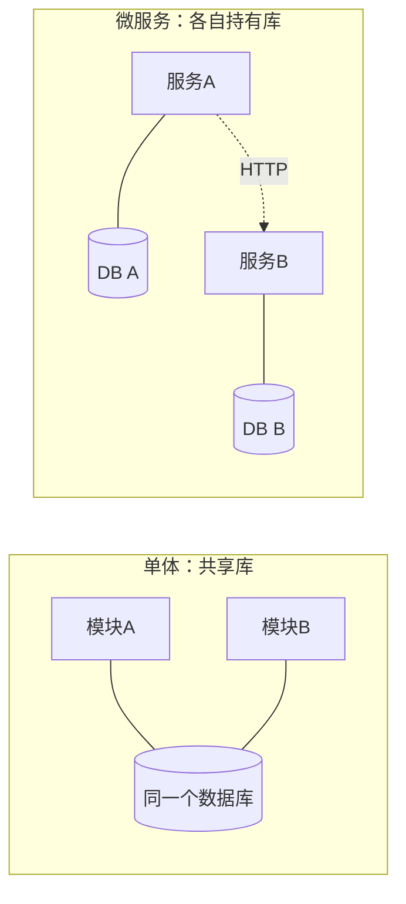
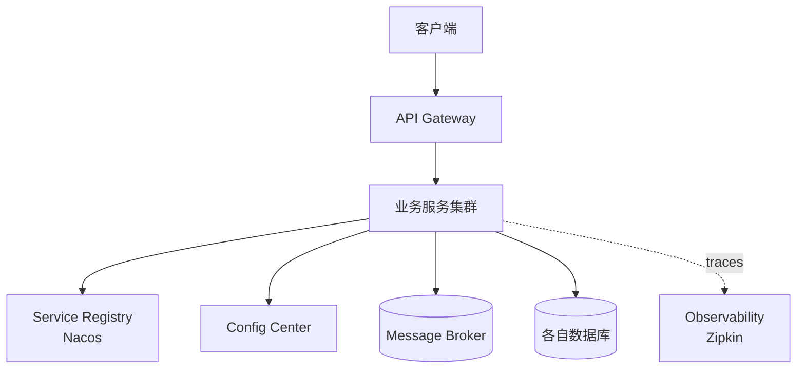

# 01 · 微服务基础概念

> 先回答「为什么」，再回答「怎么做」。前置：[00-学习路线](./00-学习路线.md)

---

## 1. 什么是微服务

一句话定义：

> **微服务 = 围绕业务能力构建的、小而自治的服务，每个服务拥有自己的数据，通过轻量级协议（通常是 HTTP/JSON 或 gRPC）通信，并可独立部署。**

关键词拆解：

| 关键词 | 含义 | 反例（不是微服务） |
|--------|------|-------------------|
| 围绕业务能力 | 按领域拆分（用户、商品、订单），不是按技术层拆分（Controller 层服务、Service 层服务） | 把所有 Controller 放一个服务、所有 DAO 放另一个服务 |
| 小而自治 | 团队可独立开发、测试、部署 | 改一行代码要 5 个团队一起发版 |
| 拥有自己的数据 | 每个服务私有数据库，别的服务只能通过 API 访问 | 多个服务直接读写同一张表 |
| 轻量级通信 | HTTP REST / gRPC / 消息队列，不用共享内存或数据库耦合 | 通过共享 jar + 直接调用 DAO |

---

## 2. 单体 vs 微服务

| 维度 | 单体架构 (Monolith) | 微服务架构 |
|------|--------------------|-----------|
| 部署单元 | 一个 war/jar | 每个服务一个 jar / 容器 |
| 团队协作 | 一个代码库，容易冲突 | 服务边界即团队边界 |
| 技术选型 | 全系统统一 | 每个服务可选最合适的技术 |
| 故障隔离 | 一个 OOM 拖垮全站 | 单个服务挂，其他服务可降级 |
| 扩展 | 整体扩容，浪费资源 | 按服务粒度扩容热点 |
| 调用方式 | 进程内方法调用（快、可靠） | 网络通信（慢、会失败） |
| 数据一致性 | 本地事务 ACID | 分布式事务复杂，通常最终一致 |
| 运维复杂度 | 低 | 高：需要注册中心、网关、链路追踪、CI/CD |
| 调试 | 一个进程，断点好打 | 跨服务问题需要 traceId 串联 |
| 适合场景 | 早期产品、小团队、需求不稳定 | 大型系统、多团队、需要独立演进 |

> **核心权衡**：微服务用「运维复杂度」换「演进速度与故障隔离」。
> 没有足够复杂度的问题，不要上微服务——你只是在给自己增加分布式系统的所有痛苦。

---

## 3. 什么时候不该拆（反向清单）

按 AGENTS.md 的精神（学习项目也要讲清楚代价），先记住这些「不该拆」的信号：

1. **团队小于 2 个 pizza 团队**（约 10-15 人）：沟通成本还没到瓶颈，拆分反而增加负担。
2. **领域边界还不清晰**：连「什么是用户、什么是订单」都在频繁变更时，服务边界会跟着反复改，成本极高。
3. **没有自动化部署与监控**：人肉运维多个服务会迅速失控。
4. **强事务一致性要求**：大量跨实体强 ACID 事务的场景，拆开后要引入分布式事务，复杂性爆炸。
5. **只是想「跟上潮流」**：架构要服务于业务问题。

> 本仓库是**学习用途**，所以刻意拆成 3 个业务服务来演示机制；这不代表真实项目一开始就该这么拆。

---

## 4. 几个必懂的概念

### 4.1 服务边界与 DDD

- **Bounded Context（限界上下文）**：一个业务术语在某个上下文里有唯一含义。「商品」在商品服务里是 SKU/库存，在订单服务里只是 `productId + 快照名称 + 下单时价格`。
- 好的微服务边界 ≈ 好的限界上下文边界。
- 实践建议：先画领域图，再画服务图；**不要按数据库表拆服务**。

### 4.2 数据自治（Database per Service）

- 别的服务**不能直接访问**你的数据库；要数据就调 API。
- 代价：跨服务 join 没了，原本一条 SQL 变成多次调用 + 应用层聚合。
- 收益：服务可以独立演进表结构，不会被别的服务"绑死"。

> 本学习项目为简化，**暂未给每个服务配独立数据库**（都用内存数据 / H2 风格），但代码结构保留了数据自治的形态。这是已知取舍，见 [Q-003](./questions.md)。

### 4.3 CAP 定理

| 字母 | 含义 |
|------|------|
| C (Consistency) | 所有节点看到的数据一致（线性一致性） |
| A (Availability) | 每个请求都能收到响应（不保证最新） |
| P (Partition tolerance) | 网络分区时系统仍能运行 |

**分布式系统中 P 是必选**，因此实际是在 C 与 A 之间取舍：

- CP：宁可拒绝服务，也不返回不一致数据（如 ZooKeeper、etcd）。
- AP：宁可返回旧数据，也要可用（如 Nacos 临时实例、Cassandra）。Nacos 在 CAP 上的取舍见 [03-Nacos](./03-Nacos服务注册与发现.md)。

### 4.4 BASE 理论

BASE = Basically Available（基本可用）+ Soft state（软状态）+ Eventually consistent（最终一致）。

- 它是 ACID 在分布式场景下的弱化版本。
- 例：下单成功后，库存扣减结果通过消息异步同步，短时间内数据不一致，但最终会一致。

### 4.5 分布式系统的 8 个谬论（The 8 Fallacies）

新手最常犯的错，就是把网络当成"可靠且免费的"：

1. 网络是可靠的 —— **不是**，会丢包、超时、断连。
2. 网络没有延迟 —— **不是**，延迟是真实成本。
3. 带宽是无限的 —— **不是**。
4. 网络是安全的 —— **不是**。
5. 拓扑不会变 —— **不是**，实例随时上下线。
6. 只有一个管理员 —— **不是**。
7. 传输是免费的 —— **不是**（序列化成本）。
8. 网络是同质的 —— **不是**。

> 阶段 6 的 Circuit Breaker / Retry / Timeout，全部是为了应对「网络会失败」这个事实。

---

## 5. 微服务的典型技术地图

| 关注点 | 本仓库选型 | 备选 |
|--------|-----------|------|
| 服务注册发现 | Nacos | Consul / Kubernetes Service |
| 服务间调用 | OpenFeign（HTTP） | gRPC / Dubbo / 消息队列 |
| 网关 | Spring Cloud Gateway | Kong / Nginx / Zuul（已淘汰） |
| 配置中心 | Spring Cloud Config（native） | Nacos Config / Apollo / Spring Cloud Bus |
| 容错 | Sentinel | Hystrix（已淘汰，不推荐） |
| 链路追踪 | Micrometer + Zipkin | SkyWalking / Jaeger / OpenTelemetry |
| 容器编排 | Docker Compose | Kubernetes |

### 5.1 已淘汰 / 不推荐使用的技术（避免踩坑）

学习时经常会在老教程里看到这些组件，这里明确说明它们的状态，以及本项目为什么不采用：

| 技术 | 状态 | 为什么不推荐 | 本项目替代方案 |
|------|------|-------------|---------------|
| **Eureka** | Netflix 已停止维护，Spring Cloud 新版本已不再集成 | 无新特性、社区停滞，继续学习它等于学死技术 | [Nacos](./03-Nacos服务注册与发现.md)（ADR-0002） |
| **Hystrix** | 已停止维护，Spring Cloud 已移除 | 同上，且性能模型老旧 | [Sentinel](./07-Sentinel熔断限流.md)（ADR-0004） |
| **Resilience4j** | 库本身仍在维护，但本项目不采用 | 在主流中文生态中流行度低于 Sentinel，且没有官方可视化控制台，教学与运维直观性不足 | [Sentinel](./07-Sentinel熔断限流.md)（ADR-0004） |
| **Zuul 1.x** | 已淘汰 | 阻塞式架构，性能差 | Spring Cloud Gateway |
| **Spring Cloud Config（Git 后端）** | 仍可用但笨重 | 需要额外 Git 仓库与凭据，配置变更链路长 | Nacos Config |

> 结论：遇到老教程里的 Eureka / Hystrix，知道它是什么即可，**不要在新项目中使用**。
> Resilience4j 是可用库，但本仓库统一用 Sentinel，保持技术栈一致。

---

## 6. 常见反模式（Anti-patterns）

| 反模式 | 症状 | 正确做法 |
|--------|------|----------|
| 分布式单体 | 服务拆了但必须一起发版 | 检查是否共享库/共享表/强同步调用链 |
| 纳米服务 | 一个服务只有一个 CRUD 方法 | 按业务能力合并，而不是按接口拆 |
| 共享数据库 | 服务间直接 join 表 | Database per Service + API 聚合 |
| 没有熔断 | 一个服务慢，全站雪崩 | Timeout + Circuit Breaker + 降级 |
| 缺少可观测性 | 出问题只能逐台看日志 | traceId 贯穿 + 集中日志 + 指标告警 |
| 过早优化 | 一上来就搞 Service Mesh | 先用 Spring Cloud 把基础打牢 |

---

## 7. 延伸思考

- 如果让你给一个「二手书交易平台」拆服务，你会先拆出哪几个？为什么？
- 「服务独立部署」和「共享一个 pipeline」矛盾吗？
- 为什么 CAP 里的 P 是必选项？

> 把你的答案或疑问写进 [questions.md](./questions.md)，AI 助手会跟进。

---

## 相关文档

- [00-学习路线](./00-学习路线.md)
- [02-项目架构总览](./02-项目架构总览.md)
- [03-Nacos服务注册与发现](./03-Nacos服务注册与发现.md)
- [decisions/0002-选择Nacos](./decisions/0002-选择Nacos作为注册与配置中心.md)
