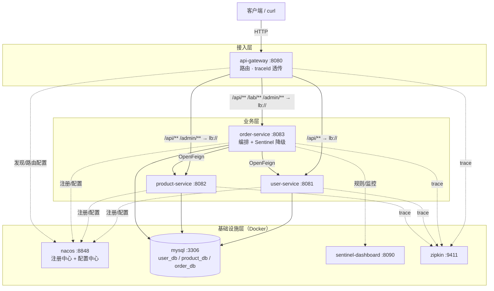
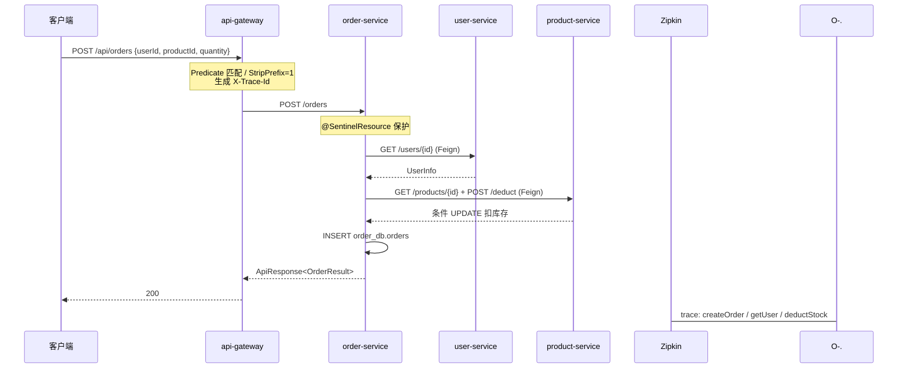
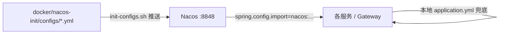

# 02 · 项目架构总览

> 一图看懂模块、端口、请求链路、配置流与版本。
> 前置：[01-微服务基础概念](./01-微服务基础概念.md)

---

## 1. 全景图



---

## 2. 模块与端口

| 模块 | 类型 | 端口 | 数据库 | 注册到 Nacos | 读 Nacos 配置 |
|------|------|------|--------|-------------|--------------|
| `common` | jar | — | — | 否 | 否 |
| `api-gateway` | Gateway (WebFlux) | 8080 | — | 是 | 是 |
| `user-service` | Spring Boot Web | 8081 | `user_db` | 是 | 是 |
| `product-service` | Spring Boot Web | 8082 | `product_db` | 是 | 是 |
| `order-service` | Spring Boot Web | 8083 | `order_db` | 是 | 是 |

| 基础设施 | 端口 | 说明 |
|----------|------|------|
| Nacos | 8848 (API) / 9848 (gRPC) / 8088→8080 (控制台) | 控制台在 `http://localhost:8088` |
| MySQL | 3306 | 三库隔离 |
| Sentinel Dashboard | 8090（宿主）→ 8858（容器） | bladex 镜像默认 8858 |
| Zipkin | 9411 | 链路 UI |

---

## 3. 核心请求链路（下单）



这条链路覆盖所有核心概念：Gateway 路由 → Nacos 发现 → Feign 调用 → Sentinel 降级 → traceId 追踪 → 真实数据库写入。

---

## 4. 配置的流向



- **本地 `application.yml`**：只放端口、服务名、Nacos 地址。
- **Nacos**：放数据源、Feign 超时、Sentinel 地址、网关路由、追踪采样等。
- 初始化由 `nacos-config-init` 容器完成，业务服务等待它 `service_completed_successfully`。

详见 [06-Nacos配置中心](./06-Nacos配置中心.md)。

---

## 5. 技术栈与版本

| 层 | 技术 | 版本 | 管理方 |
|----|------|------|--------|
| 运行时 | JDK | 25 LTS | 环境 |
| 框架 | Spring Boot | 4.0.10 | 父 POM |
| 微服务套件 | Spring Cloud | 2025.1.5 | BOM |
| Alibaba 套件 | Spring Cloud Alibaba | 2025.1.0.0 | BOM |
| Nacos | Server / Client | v3.1.1 / 3.1.1 | Docker / BOM |
| Sentinel | Core / Dashboard | 1.8.9 | BOM / Docker |
| 网关 | Gateway Server WebFlux | 5.0.5 | Cloud BOM |
| 服务调用 | OpenFeign | 5.0.4 | Cloud BOM |
| 持久层 | MyBatis-Plus | 3.5.18 | BOM |
| 数据库 | MySQL | 8.0 | Docker |
| 链路追踪 | Micrometer Tracing / Zipkin | 1.6.9 / 3.5 | Boot BOM / Docker |

版本验证过程见 [ADR-0001](./decisions/0001-技术栈与版本选型.md)。

---

## 6. 目录结构

```
microservices-learning/
├── AGENTS.md / README.md
├── pom.xml                   # 父 POM
├── docker-compose.yml        # 一键编排
├── .env.example
├── sql/init.sql              # 三库初始化
├── docker/nacos-init/        # Nacos 配置推送
├── .github/workflows/ci.yml
├── docs/                     # 文档 + ADR + 问题台账
├── common/
├── api-gateway/
├── user-service/
├── product-service/
└── order-service/
```

---

## 7. 设计取舍

| 取舍 | 做法 | 原因 |
|------|------|------|
| 注册+配置 | Nacos 3.x | 主流、二合一、控制台直观，见 ADR-0002 |
| 容错 | Sentinel | 主流、带 Dashboard，见 ADR-0004 |
| 数据库 | MySQL 8 + MyBatis-Plus，三库隔离 | 用户要求真实实现，见 ADR-0003 |
| 网关 | WebFlux 版 | 生态成熟；配置前缀 `spring.cloud.gateway.server.webflux.*` |
| 认证 | 只做 traceId 透传示例 | JWT/OAuth2 留作进阶 |
| 分布式事务 | 暂不引入 | 最终一致，Seata 留作进阶 |

---

## 相关文档

- [01-微服务基础概念](./01-微服务基础概念.md)
- [03-Nacos服务注册与发现](./03-Nacos服务注册与发现.md)
- [decisions/](./decisions/)
