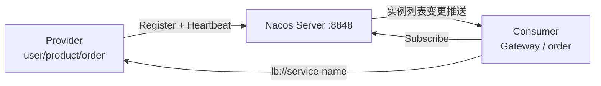

# 03 · Nacos 服务注册与发现

> 前置：[02-项目架构总览](./02-项目架构总览.md) · [ADR-0002](./decisions/0002-选择Nacos作为注册与配置中心.md)

---

## 1. 为什么是 Nacos

Nacos（Dynamic Naming and Configuration Service）同时提供 **服务注册发现** 与 **动态配置管理**，是当前国内微服务的主流选择。

| 特性 | 说明 |
|------|------|
| 维护状态 | 活跃（Alibaba / Nacos 3.x） |
| 功能 | 服务注册发现 + 动态配置管理二合一 |
| 一致性 | AP/CP 可切换（临时实例 / 永久实例） |
| 控制台 | 可在线查看实例、修改并发布配置 |
| 健康检查 | 临时实例用客户端心跳；永久实例用服务端探测 |

选型理由见 [ADR-0002](./decisions/0002-选择Nacos作为注册与配置中心.md)。

---

## 2. 核心概念



| 概念 | 说明 |
|------|------|
| Namespace | 隔离维度（如 dev/test/prod），本项目用默认 `public` |
| Group | 分组，默认 `DEFAULT_GROUP` |
| Service Name | `spring.application.name`，调用方用它做服务发现 |
| Ephemeral 实例 | 临时实例，客户端心跳上报，掉线自动剔除（本项目默认） |
| Healthy | 健康检查通过才出现在可用实例列表 |

---

## 3. 本项目实现

### 3.1 客户端依赖

每个业务服务与 Gateway 都引入：

```xml
<dependency>
  <groupId>com.alibaba.cloud</groupId>
  <artifactId>spring-cloud-starter-alibaba-nacos-discovery</artifactId>
</dependency>
```

启动类加 `@EnableDiscoveryClient`。

### 3.2 本地配置（`application.yml`）

```yaml
spring:
  application:
    name: user-service          # 注册到 Nacos 的服务名
  cloud:
    nacos:
      discovery:
        server-addr: ${NACOS_SERVER:localhost:8848}
```

Docker Compose 里注入 `NACOS_SERVER=nacos:8848`，容器间用服务名互访。

### 3.3 服务发现的使用

- Gateway 的 `lb://user-service` 由 LoadBalancer 从 Nacos 解析；
- OpenFeign 的 `@FeignClient(name = "product-service")` 同理。

见 [04-OpenFeign](./04-服务间通信-OpenFeign.md) 与 [05-Gateway](./05-API网关-Gateway.md)。

---

## 4. 动手验证

```bash
docker compose up -d nacos
# 控制台：http://localhost:8088（Nacos 3.x 控制台在 8080，学习环境关闭鉴权）

docker compose up -d user-service product-service order-service api-gateway
# 控制台「服务管理 → 服务列表」应看到 4 个服务

# 用 OpenAPI 直接查实例列表
curl 'http://localhost:8848/nacos/v1/ns/instance/list?serviceName=user-service'
```

**观察点**：停掉 `product-service` 后，实例会在心跳超时后被标记不健康/剔除。

---

## 5. 常见坑

| 现象 | 原因 | 处理 |
|------|------|------|
| Nacos 控制台打不开 | 端口映射或容器未就绪 | 看 `docker compose logs nacos` |
| 服务列表为空 | `server-addr` 写成 `localhost`（容器内指向自己） | Docker 内用 `nacos:8848` |
| 服务名显示 `UNKNOWN` | 缺 `spring.application.name` | 每个服务都配 |
| 注册报鉴权失败 | Nacos 3.x 鉴权配置不一致 | 学习环境显式 `NACOS_AUTH_ENABLE=false` |
| 实例一直不健康 | 心跳端口/网络不通 | 确认 9848 gRPC 端口已映射 |

---

## 6. 延伸思考

- 临时实例与永久实例分别适合什么场景？
- Nacos 的 AP/CP 切换对注册中心意味着什么？
- 如果 Nacos 整体宕机，已启动的服务之间还能调用吗？（提示：客户端本地缓存）

---

## 相关文档

- [06-Nacos配置中心](./06-Nacos配置中心.md)
- [ADR-0002-选择Nacos](./decisions/0002-选择Nacos作为注册与配置中心.md)
- [12-常见问题与排错](./12-常见问题与排错.md)
