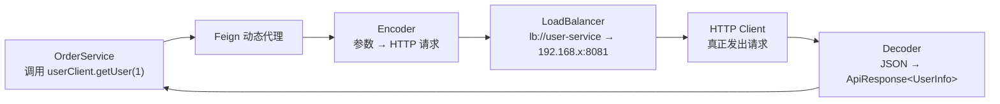

# 04 · 服务间通信（OpenFeign + LoadBalancer）

> 解决「服务之间怎么优雅地调用」。前置：[03-Nacos](./03-Nacos服务注册与发现.md)

---

## 1. 为什么需要 Feign

直接写 `RestTemplate` / `WebClient` 的问题：

- URL 拼字符串，散落各处，很容易写错；
- 服务名解析、负载均衡、超时、重试、错误处理都要重复写；
- 接口契约藏在调用代码里，无法复用。

OpenFeign 是**声明式 HTTP 客户端**：写一个 interface + 注解，Spring 帮你生成实现。

```java
@FeignClient(name = "user-service")
public interface UserClient {
    @GetMapping("/users/{id}")
    ApiResponse<UserInfo> getUser(@PathVariable("id") Long id);
}
```

调用方只需 `userClient.getUser(1L)`，看起来像本地方法，实际发的是 HTTP 请求。

---

## 2. 它是怎么工作的



关键点：

1. `@FeignClient(name = "user-service")` 里的 **name 是服务逻辑名**，不是域名。
2. 启动时加 `@EnableFeignClients`，Spring 扫描接口并注册动态代理 Bean。
3. `lb://` 前缀由 Spring Cloud LoadBalancer 解析：向 Nacos 查实例列表，按策略（默认 RoundRobin）选一个。
4. 如果 Registry 里没有这个服务，会报 `LoadBalancer` 找不到实例——不是 Feign 本身的错。

---

## 3. REST vs RPC

| 维度 | REST / HTTP JSON（本项目） | gRPC / Dubbo |
|------|---------------------------|--------------|
| 协议 | HTTP/1.1 + JSON | HTTP/2 + Protobuf |
| 性能 | 较低（文本序列化） | 高（二进制） |
| 可读性 | 高，curl 可直接调 | 低，需生成 stub |
| 契约 | OpenAPI / 文档约定 | Proto 文件强契约 |
| 适合 | 对外 API、跨语言、学习 | 内部高性能调用 |

学习阶段选 REST：调试方便，curl 就能验证。

---

## 4. 本项目实现

### 4.1 公共契约（common 模块）

 Feign 客户端和服务端共用 DTO，避免两边各写一份：

- [`ApiResponse.java`](../common/src/main/java/com/example/microservices/common/ApiResponse.java) —— 统一响应包装
- `UserInfo` / `ProductInfo` / `OrderResult` —— 跨服务传输对象

> ⚠️ 生产环境更推荐把契约单独抽成「api 模块」或借助 OpenAPI 生成，避免共享 jar 导致强耦合。学习项目为简单起见放在 common。

### 4.2 Provider（被调方）

- `user-service`：`GET /users/{id}` 返回 `ApiResponse<UserInfo>`
- `product-service`：`POST /products/{id}/deduct` 返回扣减结果

### 4.3 Consumer（调用方）

[`order-service/.../client/UserClient.java`](../order-service/src/main/java/com/example/microservices/order/client/UserClient.java)：

```java
@FeignClient(name = "user-service")
public interface UserClient {
    @GetMapping("/users/{id}")
    ApiResponse<UserInfo> getUser(@PathVariable("id") Long id);
}
```

[`ProductClient.java`](../order-service/src/main/java/com/example/microservices/order/client/ProductClient.java)：

```java
@FeignClient(name = "product-service")
public interface ProductClient {
    @GetMapping("/products/{id}")
    ApiResponse<ProductInfo> getProduct(@PathVariable("id") Long id);

    @PostMapping("/products/{id}/deduct")
    ApiResponse<Boolean> deduct(@PathVariable("id") Long id,
                                @RequestParam("quantity") int quantity);
}
```

启动类加 `@EnableFeignClients`。

### 4.4 关键配置

```yaml
spring:
  cloud:
    openfeign:
      client:
        config:
          default:
            connectTimeout: 2000      # 建连超时
            readTimeout: 3000         # 读取超时
            loggerLevel: basic        # basic / headers / full
```

> ⚠️ **一定要配超时**。Feign 默认超时较长或不设，下游慢会拖垮调用方线程——这正是 [07-Sentinel](./07-Sentinel熔断限流.md) 要解决的雪崩问题。

---

## 5. 动手验证

```bash
# 全量启动后，绕过网关直接调 order-service
curl -X POST 'http://localhost:8083/orders?userId=1&productId=1&quantity=2'

# 预期：订单创建成功，user-service / product-service 日志各出现一次调用

# 观察负载均衡：再起一个 product-service 实例
mvn -pl product-service spring-boot:run -Dspring-boot.run.arguments=--server.port=8084
# 连续下单 4 次，在 product-service 两个终端交替看到日志

# 查看 Feign 日志（loggerLevel=basic 时）
docker compose logs order-service | grep -i feign
```

---

## 6. 常见坑

| 现象 | 原因 | 处理 |
|------|------|------|
| `LoadBalancer has no servers for user-service` | 被调方没注册 / 服务名写错 | 看 Nacos 控制台「服务列表」确认实例名 |
| Feign 返回的对象字段全 null | 两端 DTO 字段名不一致 | 用 common 里同一份 DTO |
| 调用超时但下游还在执行 | 只配了 connectTimeout，没配 readTimeout | 两个都配 |
| Feign 日志看不到 | 日志级别没开 | `logging.level.<Feign接口包名>: DEBUG` |
| `@PathVariable` 报缺参数 | 没写 value/name | 显式写 `@PathVariable("id")` |

---

## 7. 延伸思考

- Feign 超时与 Sentinel 熔断的时间窗口如何配合，才不会互相打架？
- 如果 DTO 增加了一个字段，老版本服务不认识它，会怎样？（兼容性）
- 为什么超时要和熔断的时间窗口配合？

---

## 相关文档

- [03-Nacos服务注册与发现](./03-Nacos服务注册与发现.md)
- [05-API网关-Gateway](./05-API网关-Gateway.md)
- [07-Sentinel熔断限流](./07-Sentinel熔断限流.md)
- [12-常见问题与排错](./12-常见问题与排错.md)
