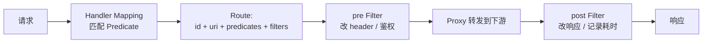

# 05 · API 网关（Spring Cloud Gateway）

> 解决「统一入口与横切关注点」。前置：[03-Nacos](./03-Nacos服务注册与发现.md)

---

## 1. 为什么需要 Gateway

没有网关时：

- 客户端要知道所有服务地址；
- 鉴权、日志、限流在每个服务重复写；
- 服务拆分/合并会直接影响客户端。

Gateway 是系统的**统一入口**：路由转发 + 横切逻辑前置 + 隐藏内部拓扑。

| 职责 | 例子 |
|------|------|
| 路由 | `/api/users/**` → `user-service` |
| 鉴权 | 校验 JWT，把 userId 透传给下游 |
| 限流 | 每 IP 每秒 10 次 |
| 日志/追踪 | 生成 traceId 并注入 header |
| 熔断 | 下游失败时返回降级响应 |
| 协议转换 | HTTP → WebSocket 等 |

---

## 2. 三个核心概念



| 概念 | 作用 | 类比 |
|------|------|------|
| **Route** | 一条规则：id + 目标 uri + predicates + filters | 一条 Nginx location |
| **Predicate** | 匹配条件（路径、Header、时间、方法…） | `if` 条件 |
| **Filter** | 在转发前/后做处理 | 拦截器（pre/post） |

内置 Predicate 举例：`Path`、`Method`、`Header`、`Query`、`Host`、`After`、`Weight`。
内置 Filter 举例：`StripPrefix`、`AddRequestHeader`、`RewritePath`、`RequestRateLimiter`、`CircuitBreaker`、`Retry`。

---

## 3. ⚠️ Boot 4 / Cloud 5 的配置前缀（必看）

旧教程写 `spring.cloud.gateway.routes`，**在本项目版本下不生效**。

经查证 [`spring-cloud-gateway-server-webflux-5.0.5.jar`](https://repo1.maven.org/maven2/org/springframework/cloud/spring-cloud-gateway-server-webflux/5.0.5/spring-cloud-gateway-server-webflux-5.0.5.jar) 内的 `spring-configuration-metadata.json`，正确前缀是：

```yaml
spring:
  cloud:
    gateway:
      server:
        webflux:
          routes:            # ← 多出来的 server.webflux 层级
            - id: user-service
              uri: lb://user-service
              predicates:
                - Path=/api/users/**
              filters:
                - StripPrefix=1
```

同时 artifact 名也变了：

```xml
<!-- ❌ 旧：spring-cloud-starter-gateway -->
<!-- ✅ 新： -->
<dependency>
  <groupId>org.springframework.cloud</groupId>
  <artifactId>spring-cloud-starter-gateway-server-webflux</artifactId>
</dependency>
```

---

## 4. 本项目实现

### 4.1 路由表

[`api-gateway/src/main/resources/application.yml`](../api-gateway/src/main/resources/application.yml)：

| Route id | Path | 目标服务 | Filter |
|----------|------|----------|--------|
| `user-service` | `/api/users/**` | `lb://user-service` | `StripPrefix=1` |
| `product-service` | `/api/products/**` | `lb://product-service` | `StripPrefix=1` |
| `order-service` | `/api/orders/**` | `lb://order-service` | `StripPrefix=1` |

`StripPrefix=1` 去掉第一段 `/api`，所以 `/api/users/1` 转发为 `/users/1`。

### 4.2 全局 Filter

[`TraceIdGlobalFilter.java`](../api-gateway/src/main/java/com/example/microservices/gateway/filter/TraceIdGlobalFilter.java)：

- 从请求头读 `X-Trace-Id`；没有则生成一个；
- 写回请求头，让下游服务和 Micrometer tracing 都能沿用它；
- 记录开始时间，在日志中打印耗时（响应头必须在响应提交前写入，否则会抛 `UnsupportedOperationException`）。

这就是「横切逻辑放网关」的最小示例。

### 4.3 服务发现集成

Gateway 集成了 Nacos Discovery，`lb://user-service` 由 LoadBalancer 从 Nacos 注册表解析。

### 4.4 限流（了解）

Cloud Gateway 内置 `RequestRateLimiter` Filter，基于 Redis + Lua 实现令牌桶。本项目**不引入 Redis**（AGENTS.md R9），仅在 [13-实验手册](./13-实验手册.md) 中给出配置示例作为扩展阅读。

---

## 5. 动手验证

```bash
# 经网关访问（注意路径带 /api 前缀）
curl -i http://localhost:8080/api/users/1
# 预期：200，响应头有 X-Trace-Id

curl -i http://localhost:8080/api/products/1
curl -X POST 'http://localhost:8080/api/orders?userId=1&productId=1&quantity=1'

# 直接访问下游仍然可以（网关不是唯一入口，只是推荐入口）
curl http://localhost:8081/users/1

# 查看网关路由表（Actuator）
curl http://localhost:8080/actuator/gateway/routes
```

> 若 `/actuator/gateway/routes` 返回空，99% 是配置前缀写错（见第 3 节）。

---

## 6. 常见坑

| 现象 | 原因 | 处理 |
|------|------|------|
| 路由不生效，`404` | 用了老前缀 `spring.cloud.gateway.routes` | 改为 `spring.cloud.gateway.server.webflux.routes` |
| 依赖拉不到 |用了老 artifact `spring-cloud-starter-gateway` | 用 `spring-cloud-starter-gateway-server-webflux` |
| 转发后下游 404 | 没配 `StripPrefix=1` | 加上，或在 Predicate 里写全路径 |
| `503 Service unavailable` | Nacos 里没有该服务 | 看 Nacos 控制台「服务列表」 |
| WebFlux 里用了 `@RestController` 返回 `ResponseEntity` 报错 | 混用 MVC 注解 | Gateway 用 WebFlux 风格（`Mono`/`@RestController` 可用，但不要用 MVC 专用类） |
| traceId 没透传 | Filter 没加 `X-Trace-Id` 到下游请求 | 检查 `mutate().header(...)` |

---

## 7. 延伸思考

- Gateway 的 Filter 和 Spring MVC 的 `HandlerInterceptor` 有什么本质区别？
- 为什么 Gateway 基于 WebFlux（响应式）而不是传统 Servlet？
- 如果网关自身挂了，整个系统就不可用——如何做网关高可用？

---

## 相关文档

- [03-Nacos服务注册与发现](./03-Nacos服务注册与发现.md)
- [04-服务间通信-OpenFeign](./04-服务间通信-OpenFeign.md)
- [08-链路追踪-Micrometer-Zipkin](./08-链路追踪-Micrometer-Zipkin.md)
- [ADR-0001](./decisions/0001-技术栈与版本选型.md)
