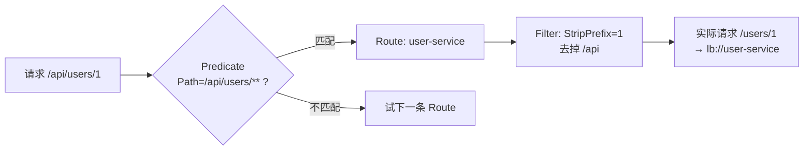

# 05b · Gateway 通俗指南（官方文档说人话版）

> 官方文档是权威，但英文 + 术语堆叠读起来费劲。这篇用**生活类比 + 项目真实例子**把 Gateway 讲明白。
> 看完这篇再回头看 [05-API网关-Gateway](./05-API网关-Gateway.md) 和[官方文档](https://docs.spring.io/spring-cloud-gateway/reference/)会轻松很多。
> 基于 Spring Cloud Gateway **5.0.5**（Cloud 2025.1.5）官方文档整理。

---

## 0. 一句话理解 Gateway

> **Gateway 就是小区的「快递分拣中心」**：所有包裹（请求）先送到这里，它看一眼地址（Predicate），
> 决定往哪条流水线送（Route），送之前还能贴个标签、拆个包装（Filter），最后交给快递员送到各家（下游服务）。

没有它，客户端得记住每家每户的门牌号（服务地址）；有了它，客户端只需要知道分拣中心一个地址。

---

## 1. 三个词，先讲人话（对应官方术语）

| 官方术语 | 人话 | 生活类比 | 项目里的例子 |
|----------|------|----------|--------------|
| **Route**（路由） | 一条「规则」：符合什么条件 → 转发到哪 | 一条分拣规则："地址是 /api/users 开头的，送 1 号楼" | `id: user-service`, `uri: lb://user-service` |
| **Predicate**（断言） | 「判断条件」，判断请求符不符合这条规则 | "地址是不是以 /api/users 开头？" | `Path=/api/users/**` |
| **Filter**（过滤器） | 「加工步骤」，转发前/后对请求做点手脚 | "贴个追踪单号"、"拆掉外层包装" | `StripPrefix=1`、`TraceIdGlobalFilter` |

**一句话关系**：`请求进来 → 用 Predicate 匹配 Route → 执行 Filter 加工 → 转发到 uri`。



---

## 2. 配置写在哪里（新手最容易懵的点）

官方文档的配置示例长这样：

```yaml
spring:
  cloud:
    gateway:
      server:          # ← 很多人漏掉这两层
        webflux:       #
          routes:
            - id: ...
```

**为什么多出 `server.webflux` 两层？** 因为新版本把网关拆成了两个实现：WebFlux 版和 MVC 版，
所以配置里要写明"我配的是 WebFlux 版"。老教程里的 `spring.cloud.gateway.routes` 在新版**不生效**（这是官方的配置结构，不是我们瞎写）。

我们项目里配置放在 **Nacos** 的 `api-gateway.yml`（不是本地文件），
由 `docker/nacos-init/init-configs.sh` 在启动时推送。本地 `application.yml` 只写"去哪拉配置"。

---

## 3. Route 的四个字段（拆开看）

官方定义一条 Route 由这几部分组成（我们项目里每一条都用了）：

```yaml
- id: user-service                    # ① 名字，随便起，唯一即可
  uri: lb://user-service              # ② 转发目标：lb:// = 从 Nacos 找实例
  predicates:                         # ③ 什么请求会走这条
    - Path=/api/users/**
  filters:                            # ④ 转发前做什么加工
    - StripPrefix=1
```

### ① id
路由的名字，日志和 actuator 里显示的就是它。起个能看懂的名字，比如 `user-service`。

### ② uri —— 重点讲 `lb://`

| 写法 | 含义 | 用在哪 |
|------|------|--------|
| `lb://user-service` | 从注册中心（Nacos）找到 `user-service` 的所有实例，负载均衡选一个 | **微服务，我们项目用的** |
| `http://localhost:8081` | 写死一个地址 | 测试、单体 |
| `https://example.org` | 转发到外部网站 | 代理外部服务 |

`lb` = Load Balanced（负载均衡）。它解决"服务实例地址会变"的问题——这也是为什么网关要配合 Nacos。

### ③ predicates —— 最常用的 `Path`

`Path=/api/users/**` 意思是：路径以 `/api/users/` 开头的请求都匹配。`**` 是通配符。

官方还支持很多别的判断条件，挑常用的说几个：

| 写法 | 意思 | 生活类比 |
|------|------|----------|
| `Path=/api/users/**` | 路径匹配 | 收件地址是这条街的 |
| `Method=GET` | 只匹配 GET 请求 | 只收"平信"不收"包裹" |
| `Header=X-Token, \d+` | 请求头符合条件 | 必须带工牌 |
| `Query=type, debug` | URL 参数符合条件 | 包裹上写了"加急" |
| `After=2026-01-01T00:00:00Z` | 某个时间之后才生效 | 限时活动 |

> 多条 Predicate 写在一起是**「且」的关系**（全部满足才匹配）。

### ④ filters —— 我们项目用到的两个

**`StripPrefix=1`**（官方文档叫 StripPrefix GatewayFilter Factory）：

> 作用：转发前**去掉路径前面的 N 段**。

官方例子：`/name/blue/red` + `StripPrefix=2` → 下游收到 `/red`。

我们项目：`/api/users/1` + `StripPrefix=1` → 下游收到 `/users/1`（去掉了 `/api` 这一段）。
为什么去掉？因为 user-service 的接口本来就是 `/users/{id}`，`/api` 只是给网关看的"门牌前缀"。

**`TraceIdGlobalFilter`**（我们自己写的**全局 Filter**）：

> Route 上配的 Filter 只对那一条路由生效；**Global Filter 对所有请求生效**，不用写进 yml。

它做两件事：请求没带 `X-Trace-Id` 就生成一个、写进请求头和响应头，然后记录耗时日志。这样 Zipkin 里能把整条链路串起来。

⚠️ 官方/我们踩过的坑：**响应头必须在转发前写**。转发后响应已提交，再改会抛 `UnsupportedOperationException`（已记入排错文档 D/G 章节）。

---

## 4. 官方的两种写法（你可能会在别处看到）

官方文档说 predicates/filters 有两种等价写法：

**快捷写法**（我们项目用的，简洁）：
```yaml
filters:
  - StripPrefix=1
```

**完整写法**（参数多时更清晰）：
```yaml
filters:
  - name: SetStatus
    args:
      status: 401
```

两者效果一样。参数多、需要命名参数时用完整写法。

---

## 5. CORS：网关的另一种配置方式（官方推荐）

我们项目用的是自己写的 `CorsWebFilter`（Java 配置），但官方文档其实提供了**在 yml 里直接配**的方式：

**全局 CORS**（对未匹配路由的请求也生效）：

```yaml
spring:
  cloud:
    gateway:
      server:
        webflux:
          globalcors:
            cors-configurations:
              '[/**]':
                allowedOrigins: "http://localhost:3000"
                allowedMethods:
                  - GET
                  - POST
```

**单路由 CORS**（写在某条 route 的 metadata 里）：

```yaml
- id: cors_route
  uri: lb://user-service
  predicates:
    - Path=/api/users/**
  metadata:
    cors:
      allowedOrigins: '*'
      allowedMethods: [GET, POST]
      allowedHeaders: '*'
```

> 我们为什么没用这个？因为当时先用 `CorsWebFilter` 解决了问题，功能等价。如果你想改成官方 yml 方式，把 `GatewayCorsConfig.java` 删掉、在 Nacos 的 `api-gateway.yml` 加上面的配置即可——效果一样，配置更集中。

---

## 6. 路由转发时，请求头发生了什么？（面试常问）

Gateway 转发请求时，默认会**保留原始请求头**，但有几个特殊头会被处理（官方叫 `Forwarded` / `X-Forwarded-*`）：

- 下游服务看到的请求**来源 IP** 可能是网关的，不是真实客户端的
- 如果下游要拿真实 IP，需要看 `X-Forwarded-For` / `X-Forwarded-Proto` 这类头
- 我们的 `TraceIdGlobalFilter` 往请求头里塞了 `X-Trace-Id`，这个头会原样传到下游，所以 Zipkin 能串起来

---

## 7. 调试技巧（官方 actuator）

Gateway 自带 actuator 端点能看路由。要暴露它，在配置里加：

```yaml
management:
  endpoints:
    web:
      exposure:
        include: gateway,health,info
```

然后：`curl http://localhost:8080/actuator/gateway/routes` 能看到所有生效的路由。

> 我们项目当前的 `shared-config.yml` 里 `include` 没有 `gateway`，所以这个端点是 404。想调试路由时可以加上。

---

## 8. 官方文档哪里看（给你个导航）

英文文档虽然头疼，但知道结构就好找了：

| 想查什么 | 官方文档页面关键词 |
|----------|-------------------|
| 配置前缀、写法 | `Configuration` |
| Predicate 有哪些 | `Route Predicate Factories` |
| Filter 有哪些 | `GatewayFilter Factories` |
| 全局 Filter | `Global Filters` |
| CORS | `CORS Configuration` |
| actuator 端点 | `Actuator API` |

官方网址：`https://docs.spring.io/spring-cloud-gateway/reference/spring-cloud-gateway-server-webflux.html`
（如果打不开，GitHub 仓库 `spring-cloud/spring-cloud-gateway` 的 `docs/modules/ROOT/pages/` 目录里有同样的 `.adoc` 源文件，这篇文档就是查那些文件写的。）

---

## 相关文档

- [05-API网关-Gateway](./05-API网关-Gateway.md) —— 更完整的术语与版本说明
- [03-Nacos服务注册与发现](./03-Nacos服务注册与发现.md) —— `lb://` 背后的服务发现
- [08-链路追踪-Micrometer-Zipkin](./08-链路追踪-Micrometer-Zipkin.md) —— traceId 如何串起链路
- [12-常见问题与排错](./12-常见问题与排错.md) —— CORS、响应头踩坑记录
