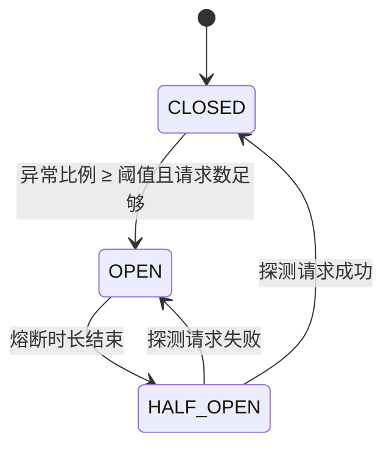

# 07 · Sentinel 熔断限流降级

> 前置：[04-服务间通信-OpenFeign](./04-服务间通信-OpenFeign.md) · [ADR-0004](./decisions/0004-选择Sentinel作为容错组件.md)

---

## 1. 为什么需要 Sentinel

微服务中依赖必然失败。没有保护时：

- 下游变慢 → 调用方线程被占满 → 雪崩；
- 突发流量 → 服务被打垮；
- 下游宕机 → 错误层层传导。

Sentinel 以「流量」为切入点，提供流控、熔断降级、系统负载保护，并带**可视化控制台**可实时改规则。

选型理由见 [ADR-0004](./decisions/0004-选择Sentinel作为容错组件.md)。

---

## 2. 核心概念

| 概念 | 说明 |
|------|------|
| Resource | 被保护的资源，通常是方法名或 URL，本项目用 `createOrder` |
| Rule | 规则：流控（FlowRule）、熔断降级（DegradeRule）、系统保护（SystemRule） |
| blockHandler | 被 Sentinel **主动拒绝**（限流/系统保护）时调用 |
| fallback | 资源**抛出异常**（下游故障/业务异常）时调用 |

> **blockHandler vs fallback**：前者处理「我主动拒绝你」，后者处理「我调用别人失败了」。



---

## 3. 本项目实现

### 3.1 依赖与配置

`order-service/pom.xml`：

```xml
<dependency>
  <groupId>com.alibaba.cloud</groupId>
  <artifactId>spring-cloud-starter-alibaba-sentinel</artifactId>
</dependency>
<!-- Boot 4 无 aop starter，@SentinelResource 需要 aspectjweaver -->
<dependency>
  <groupId>org.aspectj</groupId>
  <artifactId>aspectjweaver</artifactId>
</dependency>
```

Nacos 中的 `order-service.yml`：

```yaml
spring.cloud.sentinel:
  transport:
    dashboard: sentinel-dashboard:8858   # bladex 镜像监听 8858
    port: 8719                            # 客户端与控制台通信端口
  eager: true                             # 启动即初始化，不等首次访问
```

### 3.2 注解式保护

[`OrderService.java`](../order-service/src/main/java/com/example/microservices/order/service/OrderService.java)：

```java
@SentinelResource(value = "createOrder",
        blockHandler = "createOrderBlockHandler",
        fallback = "createOrderFallback")
public ApiResponse<OrderResult> createOrder(Long userId, Long productId, int quantity) {
    // Feign 调 user-service / product-service，写订单表
}
```

⚠️ 注解全限定名：`com.alibaba.csp.sentinel.annotation.SentinelResource`。

**签名规则**：`blockHandler` / `fallback` 的参数必须与原方法一致，最后多一个异常参数
（`BlockException` / `Throwable`）。

### 3.3 代码注册规则

[`SentinelRuleConfig.java`](../order-service/src/main/java/com/example/microservices/order/config/SentinelRuleConfig.java)：

- FlowRule：`createOrder` QPS 上限 20；
- DegradeRule：异常比例 > 50%（最少 3 个请求）→ 熔断 10 秒。

代码注册保证「不开控制台也有保护」；打开 Dashboard 后可在线调整（存内存，重启失效）。

---

## 4. 动手验证（故障注入）

```bash
# 1. 正常下单
curl -X POST 'http://localhost:8080/api/orders?userId=1&productId=1&quantity=1'

# 2. 停掉商品服务，制造下游故障
docker compose stop product-service

# 3. 连续下单，观察 fallback 生效（返回 503 + "降级" 文案）
for i in $(seq 1 6); do
  curl -s -X POST 'http://localhost:8080/api/orders?userId=1&productId=1&quantity=1'
  echo
done

# 4. 打开 Sentinel Dashboard http://localhost:8090
#   找到 order-service → 查看 createOrder 的实时监控与异常比例

# 5. 恢复
docker compose start product-service
sleep 12
curl -X POST 'http://localhost:8080/api/orders?userId=1&productId=1&quantity=1'
```

**观察点**：熔断期间请求被快速拒绝（不再调用下游），恢复后半开探测成功回到 CLOSED。

---

## 5. 常见坑

| 现象 | 原因 | 处理 |
|------|------|------|
| `@SentinelResource` 不生效 | 缺 aspectjweaver | 显式引入 |
| 注解类找不到 | 导错包 | 用 `com.alibaba.csp.sentinel.annotation.SentinelResource` |
| blockHandler/fallback 找不到 | 签名不匹配 | 参数一致 + 末尾异常参数 |
| Dashboard 看不到应用 | 首次访问前未初始化 / 端口错 | `eager: true`；容器网络内用 `sentinel-dashboard:8858` |
| 宿主机 8090 打不开 | bladex 镜像监听 8858 | Compose 映射 `"8090:8858"` |
| 规则重启后丢失 | 规则存内存 | 需要接 Nacos datasource 持久化（进阶） |

---

## 6. 延伸思考

- 限流规则应放在网关还是业务服务？各有什么优劣？
- Sentinel 规则持久化到 Nacos 需要注意什么？
- fallback 里为什么不能再发远程调用？

---

## 相关文档

- [04-服务间通信-OpenFeign](./04-服务间通信-OpenFeign.md)
- [ADR-0004-选择Sentinel](./decisions/0004-选择Sentinel作为容错组件.md)
- [13-实验手册](./13-实验手册.md)
