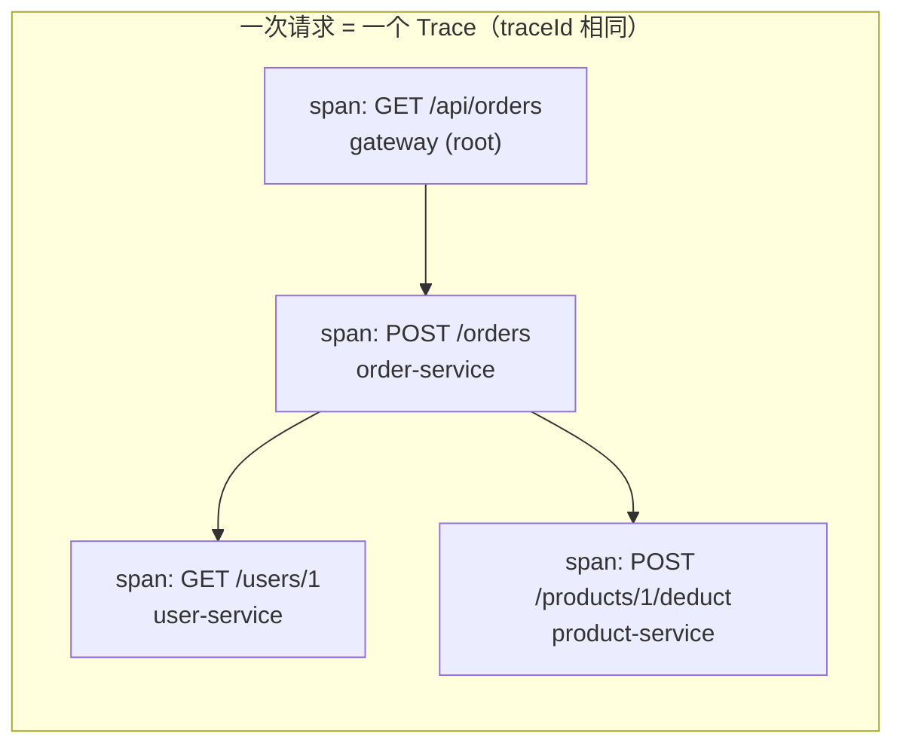

# 08 · 链路追踪（Micrometer Tracing + Zipkin）

> 解决「一个请求跨了 4 个服务，出问题怎么定位」。前置：[04-OpenFeign](./04-服务间通信-OpenFeign.md)

---

## 1. 可观测性三支柱

| 支柱 | 回答的问题 | 本项目工具 |
|------|-----------|-----------|
| Logs 日志 | 某个时刻发生了什么 | 控制台 + Docker logs |
| Metrics 指标 | 发生了多少、多快、多少错误 | Actuator / Micrometer |
| Traces 链路 | 一次请求经过了哪些服务、哪一步慢 | Micrometer + Zipkin |

微服务里排查问题最痛的是：**一个请求跨多个进程，日志散落各处**。链路追踪用一个 `traceId` 把它们串起来。

---

## 2. 核心概念



| 概念 | 说明 |
|------|------|
| Trace | 一次完整请求，全局唯一 `traceId` |
| Span | Trace 中的一个工作单元，有 `spanId`、`parentId`、耗时、标签 |
| Propagation | 跨进程传递 trace 上下文（HTTP header） |
| Sampling | 采样率：1.0 全采，0.1 采 10% |

传播协议常见两种：**W3C Trace Context**（`traceparent` header，推荐）和 **B3**（`X-B3-TraceId`）。Micrometer Brave 默认两者都能处理。

---

## 3. 本项目实现

### 3.1 依赖（每个服务 + Gateway）

```xml
<dependency>
  <groupId>org.springframework.boot</groupId>
  <artifactId>spring-boot-starter-actuator</artifactId>
</dependency>
<dependency>
  <groupId>io.micrometer</groupId>
  <artifactId>micrometer-tracing-bridge-brave</artifactId>
</dependency>
<dependency>
  <groupId>io.zipkin.reporter2</groupId>
  <artifactId>zipkin-reporter-brave</artifactId>
</dependency>
```

> Boot 4 另提供 `spring-boot-micrometer-tracing-brave` 模块；本项目用经典组合（版本由 Boot BOM 管理：tracing 1.6.9 / reporter 3.5.3），已在 ADR-0001 验证存在。

### 3.2 配置（`docker/nacos-init/configs/shared-config.yml`，所有客户端共享）

```yaml
management:
  tracing:
    sampling:
      probability: 1.0        # 学习环境全采样
  zipkin:
    tracing:
      endpoint: ${ZIPKIN_ENDPOINT:http://localhost:9411/api/v2/spans}
  endpoints:
    web:
      exposure:
        include: health,info,env,configprops,refresh,metrics
  observations:
    key-values:
      application: ${spring.application.name}
logging:
  pattern:
    level: "%5p [${spring.application.name},%X{traceId:-},%X{spanId:-}]"
```

`%X{traceId}` 让日志自动带上 traceId——这是「不用改代码就能串日志」的关键。

### 3.3 Gateway 的 traceId 透传

[`TraceIdGlobalFilter`](../api-gateway/src/main/java/com/example/microservices/gateway/filter/TraceIdGlobalFilter.java) 会把 `X-Trace-Id` 写进下游请求头；Micrometer 通过 W3C/B3 header 传播上下文，Zipkin 中同一条链路的 traceId 一致。

### 3.4 Zipkin 容器

见 [`docker-compose.yml`](../docker-compose.yml) 的 `zipkin` 服务，镜像固定 `openzipkin/zipkin:3.5`。

---

## 4. 动手验证

```bash
# 1. 启动 Zipkin
docker compose up -d zipkin

# 2. 发一次完整请求
curl -i -X POST 'http://localhost:8080/api/orders?userId=1&productId=1&quantity=1'
# 留意响应头 X-Trace-Id

# 3. 打开 Zipkin UI http://localhost:9411
# 点击 "Run Query" → Find Traces → 点开最上面一条
# 预期看到 4 个 span：gateway / order / user / product

# 4. 观察某个 span 的 Tags / Annotations，看耗时分布

# 5. 采样率实验：在 Nacos 控制台把 shared-config.yml 改成 0.1
#    refresh 后发 20 次请求，Zipkin 里大约只出现 2 条链路
```

---

## 5. 常见坑

| 现象 | 原因 | 处理 |
|------|------|------|
| Zipkin 没数据 | sampling.probability=0.0 或 endpoint 错 | 设 1.0；检查 `ZIPKIN_ENDPOINT` |
| Docker 里上报失败 | 用了 localhost | 用服务名 `http://zipkin:9411/api/v2/spans` |
| 日志里 traceId 是空 | logging.pattern 没配 `%X{traceId}` | 加上 |
| 链路断裂，每个服务一个 trace | 传播 header 被 Filter 清掉 | 检查自定义 Filter 的 `mutate().header()` |
| 看不到 span 名称 | 没加 actuator / observation 被关闭 | 检查依赖与配置 |

---

## 6. 延伸思考

- 采样率设 1.0 在生产环境有什么问题？
- traceId 如何作为「排查入口」写进用户可见的错误信息？
- OpenTelemetry 与 Micrometer Tracing 的关系是什么？

---

## 相关文档

- [05-API网关-Gateway](./05-API网关-Gateway.md)
- [07-Sentinel熔断限流](./07-Sentinel熔断限流.md)
- [ADR-0001-技术栈与版本选型](./decisions/0001-技术栈与版本选型.md)
- [12-常见问题与排错](./12-常见问题与排错.md)
