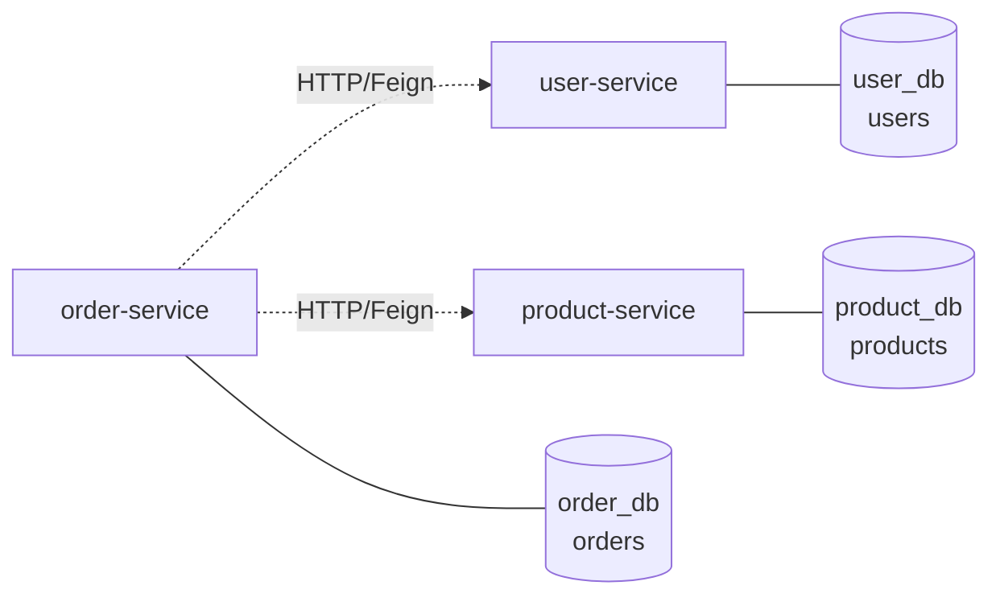

# 09 · 真实数据库与 MyBatis-Plus

> 用户明确要求「真实，可以直接使用数据库而不是模拟」。本项目不使用内存 Map，
> 三个服务各自拥有独立 MySQL schema。前置：[02-项目架构总览](./02-项目架构总览.md)

---

## 1. Database per Service



- 每个服务**只访问自己的 schema**，不跨库 join；
- 订单里只保存 `userId` / `productId` 与下单时的价格快照，不直接读别人库；
- 三个 schema 在同一个 MySQL 容器里，是学习环境的简化；生产可拆成独立实例。

> 这意味着跨服务没有本地事务，订单创建与库存扣减是「最终一致」而非强一致。
> 分布式事务（Seata / Outbox）留作进阶主题（AGENTS.md R9）。

---

## 2. 表结构

初始化脚本：[`sql/init.sql`](../sql/init.sql)，由 MySQL 容器首次启动时自动执行。

| 库 | 表 | 关键字段 |
|----|----|----------|
| `user_db` | `users` | id, username(unique), nickname, email |
| `product_db` | `products` | id, name, price DECIMAL(10,2), stock |
| `order_db` | `orders` | id, order_no(unique), user_id, product_id, quantity, amount, status |

---

## 3. MyBatis-Plus 用法

### 3.1 依赖与实体

Boot 4 专用 starter：`com.baomidou:mybatis-plus-spring-boot4-starter:3.5.18`。

```java
@TableName("products")
public class Product {
    @TableId(type = IdType.AUTO)
    private Long id;
    private String name;
    private BigDecimal price;
    private Integer stock;
    // getter / setter
}
```

### 3.2 Mapper

```java
public interface ProductMapper extends BaseMapper<Product> {
    @Update("UPDATE products SET stock = stock - #{qty} WHERE id = #{id} AND stock >= #{qty}")
    int deductStock(@Param("id") Long id, @Param("qty") int qty);
}
```

`BaseMapper` 提供单表 CRUD；`deductStock` 是自定义 SQL。

### 3.3 防超卖的关键

```java
int rows = productMapper.deductStock(id, quantity);
if (rows == 0) {
    throw new BusinessException(ErrorCode.CONFLICT, "库存不足或商品不存在");
}
```

「判断库存 + 扣减」在**一条条件 UPDATE** 中由数据库原子完成，避免「先查后改」的竞态。

### 3.4 数据源配置（在 Nacos）

以 `user-service.yml` 为例：

```yaml
spring:
  datasource:
    url: jdbc:mysql://${MYSQL_HOST:mysql}:3306/user_db?...&allowPublicKeyRetrieval=true
    username: ${MYSQL_USER:root}
    password: ${MYSQL_PASSWORD}
    driver-class-name: com.mysql.cj.jdbc.Driver
    hikari:
      maximum-pool-size: 10
```

连接 URL 与密码都在 Nacos，本地 `application.yml` 不含敏感信息。

---

## 4. 动手验证

```bash
docker compose up -d mysql
# 进入 MySQL 容器查看真实数据
docker compose exec mysql mysql -uroot -proot123456 -e \
  'SELECT id,name,price,stock FROM product_db.products;'

# 下单后看库存真的减少了
curl -X POST 'http://localhost:8080/api/orders?userId=1&productId=1&quantity=2'
docker compose exec mysql mysql -uroot -proot123456 -e \
  'SELECT id,stock FROM product_db.products WHERE id=1; SELECT * FROM order_db.orders;'

# 超卖测试：库存 20 的商品一次买 100
curl -X POST 'http://localhost:8080/api/orders?userId=1&productId=2&quantity=100'
# 预期 409 CONFLICT
```

---

## 5. 常见坑

| 现象 | 原因 | 处理 |
|------|------|------|
| 表不存在 | init.sql 未执行（数据卷已初始化过） | `docker compose down -v` 后重建（会清数据） |
| 连接被拒绝 | 服务先于 MySQL 就绪 | Compose 已配 healthcheck + `condition: service_healthy` |
| `Public Key Retrieval is not allowed` | MySQL 8 驱动需要参数 | URL 加 `allowPublicKeyRetrieval=true` |
| 中文乱码 | 字符集不对 | 库/表用 `utf8mb4`，URL 加 `characterEncoding=utf8` |
| 金额精度丢失 | 用 double/float | 用 `BigDecimal` 对应 `DECIMAL` |
| 超卖 | 先查后改有竞态 | 用条件 UPDATE |

---

## 6. 相关文档

- [02-项目架构总览](./02-项目架构总览.md)
- [ADR-0006-引入真实MySQL与MyBatis-Plus](./decisions/0006-引入真实MySQL与MyBatis-Plus.md)
- [13-实验手册](./13-实验手册.md)
