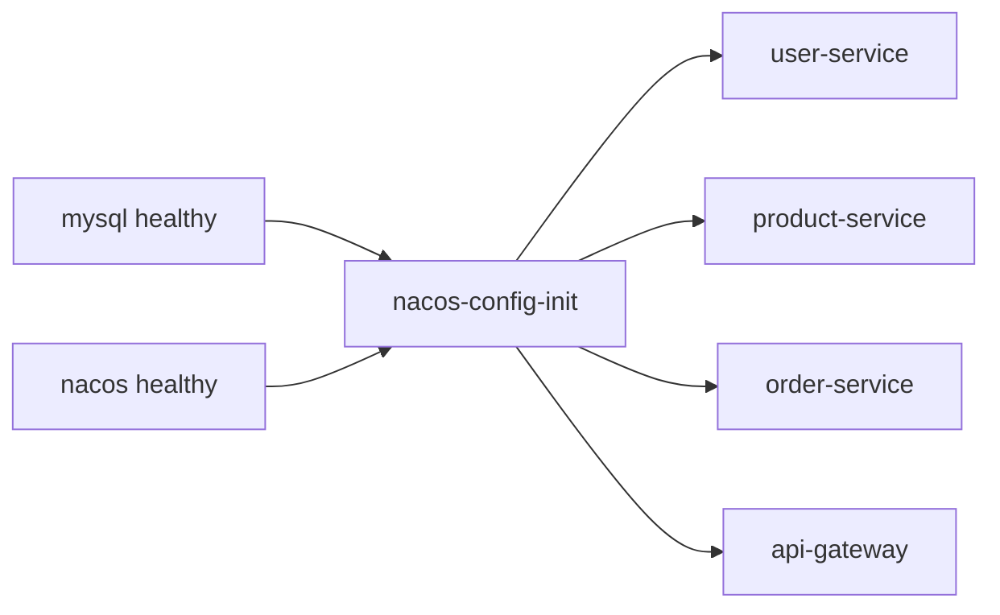

# 09b · 容器化与编排（Docker Compose）

> 解决「我本地能跑，别人怎么一键跑」。前置：[02-项目架构总览](./02-项目架构总览.md)

---

## 1. 启动全栈（两步）

```bash
mvn -q -DskipTests package   # 先在宿主机构建 jar（依赖已缓存，秒级）
docker compose up -d --build # 再构建镜像并启动容器
docker compose ps
docker compose logs -f order-service
docker compose down
docker compose down -v   # 连同 MySQL 数据卷一起删除，谨慎
```

> 镜像只把 jar 装进 JRE，不在容器里重新下载 Maven 依赖。改代码后重跑这两步。

---

## 2. Compose 里的启动顺序



关键点：

- `depends_on` 只保证容器启动，**不保证应用就绪**，所以 MySQL / Nacos 配了 healthcheck；
- 业务服务用 `condition: service_healthy` 等数据库和 Nacos；
- 配置初始化容器用 `service_completed_successfully`，确保配置推送完成后业务服务才启动。

---

## 3. 多阶段 Dockerfile

以 `user-service/Dockerfile` 为例：

```dockerfile
FROM maven:3.9-eclipse-temurin-25 AS builder
WORKDIR /build
COPY pom.xml ./
COPY common ./common
COPY user-service ./user-service
RUN mvn -q -DskipTests -pl user-service -am package

FROM eclipse-temurin:25-jre
WORKDIR /app
COPY --from=builder /build/user-service/target/user-service-*.jar app.jar
EXPOSE 8081
ENTRYPOINT ["java", "-jar", "/app/app.jar"]
```

| 做法 | 原因 |
|------|------|
| 多阶段构建 | 运行镜像不含 Maven 与源码，体积小 |
| 固定基础镜像 tag | 避免 `latest` 导致构建不可复现 |
| 用 JRE 而非 JDK | 运行只需 JRE |

---

## 4. 环境变量

统一通过 Compose 注入，业务服务的 `application.yml` 只保留本地默认值：

| 变量 | 用途 |
|------|------|
| `NACOS_SERVER` | Nacos 地址，容器内为 `nacos:8848` |
| `MYSQL_HOST` / `MYSQL_USER` / `MYSQL_PASSWORD` | 数据源 |
| `ZIPKIN_ENDPOINT` | 链路上报地址 |
| `SENTINEL_DASHBOARD` | 控制台地址，容器内为 `sentinel-dashboard:8858` |

敏感值模板在 [`.env.example`](../.env.example)，实际 `.env` 已 gitignore。

---

## 5. 端口总表

| 服务 | 宿主端口 | 容器端口 |
|------|----------|----------|
| api-gateway | 8080 | 8080 |
| user-service | 8081 | 8081 |
| product-service | 8082 | 8082 |
| order-service | 8083 | 8083 |
| Sentinel Dashboard | 8090 | 8858 |
| Nacos | 8848 / 9848 | 8848 / 9848 |
| Zipkin | 9411 | 9411 |
| MySQL | 3306 | 3306 |

---

## 6. 常见坑

| 现象 | 原因 | 处理 |
|------|------|------|
| 服务连不上数据库 | 只等容器启动没等健康 | healthcheck + `condition: service_healthy` |
| Sentinel Dashboard 8090 打不开 | bladex 镜像监听 8858，不是 8080 | Compose 映射 `8090:8858` |
| Nacos 配置没推送 | init 容器失败 | `docker compose logs nacos-config-init` |
| 改了 SQL 不生效 | 数据卷已初始化 | `down -v` 重建（清数据） |
| 端口被占用 | 宿主已有同端口 | 改 Compose 左侧映射 |

---

## 相关文档

- [10-CI-CD-GitHub-Actions](./10-CI-CD-GitHub-Actions.md)
- [13-实验手册](./13-实验手册.md)
