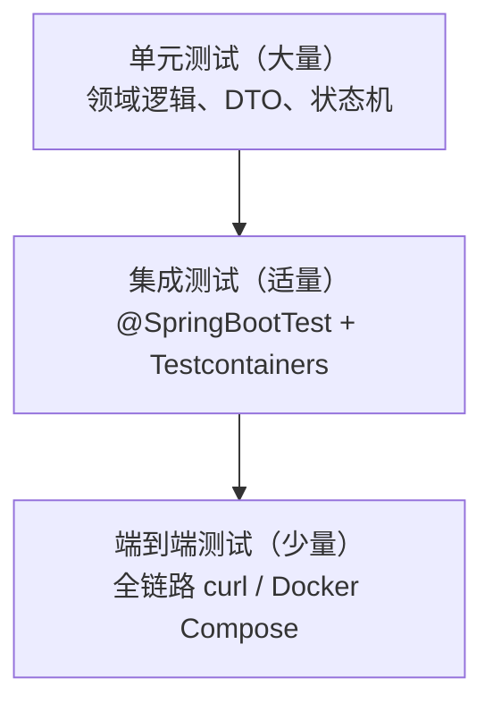

# 11 · 测试策略

> 微服务测试的关键问题：哪些用单元测试，哪些必须拉起依赖。
> 前置：[04-OpenFeign](./04-服务间通信-OpenFeign.md)

---

## 1. 测试金字塔在微服务中的变形



| 层 | 测什么 | 速度 | 稳定性 | 本项目 |
|----|--------|------|--------|--------|
| 单元测试 | Service 逻辑、计算、状态转换 | 快（毫秒） | 高 | ✅ 有 |
| 上下文测试 | Gateway 上下文与路由配置加载 | 中 | 中 | ✅ 有 |
| 契约测试 | Provider/Consumer 契约一致 | 中 | 高 | ⬜ 进阶（Spring Cloud Contract） |
| 端到端 | 全链路，真实 Nacos/MySQL | 慢 | 低 | 手工（[13-实验手册](./13-实验手册.md)） |

> 微服务里 E2E 测试最脆弱（依赖多、网络抖动），所以重心放在**单测 + 上下文测试**，E2E 只验证主链路。

---

## 2. 本项目的测试清单

| 模块 | 测试 | 覆盖点 |
|------|------|--------|
| common | `ApiResponseTest` | 成功/失败构造、字段 |
| user-service | `UserServiceTest` | 查询不存在时抛 BusinessException |
| product-service | `ProductServiceTest` | 库存不足抛异常、非正数数量被拒绝 |
| order-service | `OrderServiceTest` | 下单成功、Feign mock、金额计算、订单落库 |
| api-gateway | `GatewayApplicationTests`（上下文加载） | Boot 4 新配置前缀下路由能被解析 |

测试文件位置：`各模块/src/test/java/...`。

---

## 3. 常用工具与写法

### 3.1 Mockito（隔离外部依赖）

```java
@ExtendWith(MockitoExtension.class)
class OrderServiceTest {
    @Mock UserClient userClient;
    @Mock ProductClient productClient;
    @InjectMocks OrderService orderService;

    @Test
    void createOrder_shouldCallBothDependencies() {
        when(userClient.getUser(1L)).thenReturn(ApiResponse.ok(userInfo));
        when(productClient.getProduct(1L)).thenReturn(ApiResponse.ok(productInfo));

        ApiResponse<OrderResult> result = orderService.createOrder(1L, 1L, 1);

        assertThat(result.isSuccess()).isTrue();
        verify(userClient).getUser(1L);
        verify(productClient).deduct(1L, 1);
    }
}
```

### 3.2 MockMvc（Web 层集成测试）

```java
@SpringBootTest
@AutoConfigureMockMvc
class UserControllerTest {
    @Autowired MockMvc mockMvc;

    @Test
    void getUser_shouldReturn200() throws Exception {
        mockMvc.perform(get("/users/1"))
               .andExpect(status().isOk())
               .andExpect(jsonPath("$.code").value(200));
    }
}
```

### 3.3 测试时关闭外部依赖

单测/上下文测试不应依赖真实 Nacos / MySQL：

```yaml
# src/test/resources/application.yml
spring:
  cloud:
    nacos:
      config:
        enabled: false
      discovery:
        enabled: false
    sentinel:
      enabled: false
```

---

## 4. 运行测试

```bash
mvn test                                  # 全部
mvn -pl user-service test                 # 单模块
mvn -pl order-service -Dtest=OrderServiceTest test
mvn -B clean test                         # 模拟 CI（务必用 clean）
```

---

## 5. 常见坑

| 现象 | 原因 | 处理 |
|------|------|------|
| 测试卡在连接 Nacos | 没禁用注册/配置 | `spring.cloud.nacos.discovery.enabled=false` + `config.enabled=false` |
| `@SpringBootTest` 启动很慢 | 加载了全部自动配置 | 收窄 `@SpringBootTest(classes=...)` |
| Mock 不生效 | 注解/注入方式不对 | 用 `@ExtendWith(MockitoExtension.class)` + `@InjectMocks` |
| WebFlux 模块用 MockMvc 报错 | Gateway 是 WebFlux，需 `WebTestClient` | 用 `@AutoConfigureWebTestClient` |
| CI 与本地结果不同 | 本地未 clean | CI 与本地都用 `mvn clean test` |

---

## 6. 相关文档

- [10-CI-CD-GitHub-Actions](./10-CI-CD-GitHub-Actions.md)
- [13-实验手册](./13-实验手册.md)
- [ADR-0001](./decisions/0001-技术栈与版本选型.md)
