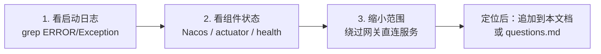

# 12 · 常见问题与排错（持续追加）

> 遇到问题时**先查这里**。按 AGENTS.md R12，每轮对话产生的新认知都要追加。
> 最后更新：2026-11-23

---

## 0. 排错三板斧



```bash
docker compose ps
docker compose logs --tail=200 <service>
curl -s http://localhost:8081/actuator/health | jq .
curl -s http://localhost:8848/nacos/v1/ns/instance/list?serviceName=user-service
mvn -q -DskipTests compile   # 先确认不是编译问题
```

---

## 1. 构建 / 依赖类

| # | 现象 | 根因 | 解决 |
|---|------|------|------|
| B-1 | `Could not find artifact spring-cloud-starter-gateway` | Boot 4 / Cloud 5 已改名 | 用 `spring-cloud-starter-gateway-server-webflux`，见 ADR-0001 |
| B-2 | `spring-boot-starter-aop` 找不到 | Boot 4 移除该 starter | 显式加 `org.aspectj:aspectjweaver` |
| B-3 | Gateway 路由配置不生效 | 配置前缀变了 | 用 `spring.cloud.gateway.server.webflux.*` |
| B-4 | Java 25 报 `Unsupported class file major version 69` | Spring Framework 版本过低 | 保持 Boot 4 / Cloud 5 组合 |
| B-5 | `com.alibaba.cloud:spring-cloud-starter-openfeign` 找不到 | groupId 写错 | OpenFeign 的 groupId 是 `org.springframework.cloud` |
| B-6 | `SentinelResource` 找不到符号 | 导错包 | 用 `com.alibaba.csp.sentinel.annotation.SentinelResource` |
| B-7 | `getData()` 编译失败 | `ApiResponse` 是 record | 用 `data()` |
| B-8 | `common` 报 `package org.slf4j does not exist` | 只依赖 spring-web，不含日志门面 | 显式加 `org.slf4j:slf4j-api` |
| B-9 | 子模块版本冲突 | 子模块硬编码版本 | 所有版本由父 POM BOM 管理 |

---

## 2. 启动 / 注册 / 配置类

| # | 现象 | 根因 | 解决 |
|---|------|------|------|
| S-1 | Nacos 控制台打不开 | Nacos 3.x 控制台在容器 8080，不是 8848 | `docker compose logs nacos`；访问 `http://localhost:8088` |
| S-2 | Nacos 启动报 token 相关错误 | `NACOS_AUTH_TOKEN` 不是合法 Base64 或长度不足 | 用 compose 中提供的默认值（Base64，≥32 字节） |
| S-3 | 服务列表为空 | `server-addr` 在容器内写成 `localhost` | Docker 内用 `nacos:8848` |
| S-4 | 服务名显示 UNKNOWN | 缺 `spring.application.name` | 每个服务都配 |
| S-5 | 业务服务启动失败，提示找不到 dataId | `nacos-config-init` 未成功 | 看 init 容器日志；确认 dataId 与文件名一致 |
| S-6 | 容器网络内连不上 MySQL | 用了 localhost | 用 `mysql:3306`，Compose 已注入 `MYSQL_HOST` |
| S-7 | 实例一直不健康 | gRPC 端口 9848 未映射 | Compose 已映射 8848/9848 |

---

## 3. 调用 / 容错 / 数据类

| # | 现象 | 根因 | 解决 |
|---|------|------|------|
| C-1 | `LoadBalancer has no servers for xxx` | 服务未注册 / 名字写错 | 看 Nacos 控制台「服务列表」 |
| C-2 | Feign 返回字段全 null | 两端 DTO 不一致 | 共用 common 中的 DTO |
| C-3 | `@SentinelResource` 不生效 | 缺 aspectjweaver / 签名不匹配 | 显式引入；参数一致 + 末尾异常参数 |
| C-4 | Dashboard 看不到应用 | 未初始化或端口错 | `eager: true`；容器网络内用 `sentinel-dashboard:8858` |
| C-5 | `Public Key Retrieval is not allowed` | MySQL 8 驱动安全策略 | URL 加 `allowPublicKeyRetrieval=true` |
| C-6 | 表不存在 | init.sql 未执行（数据卷已初始化过） | `docker compose down -v` 后重建（会清数据） |
| C-7 | 超卖 | 先查后改有竞态 | 用条件 `UPDATE ... WHERE stock >= qty` |

---

## 4. 网关 / 链路类

| # | 现象 | 根因 | 解决 |
|---|------|------|------|
| G-1 | 网关 404 | 路由写在本地而非 Nacos，或前缀错 | 路由在 `api-gateway.yml`，前缀 `spring.cloud.gateway.server.webflux.*` |
| G-2 | 转发后下游 404 | 缺 `StripPrefix=1` | 加上 |
| G-3 | Zipkin 无数据 | 采样率 0 / endpoint 错 | shared-config 中设 1.0；容器网络内用 `http://zipkin:9411/api/v2/spans` |
| G-4 | 链路断裂 | 自定义 Filter 清掉传播 header | 保留 `traceparent` / `X-B3-*` / `X-Trace-Id` |
| G-5 | 网关返回 503，日志有 `UnsupportedOperationException` | 在 `doFinally` 里写响应头，此时响应已提交且 header 只读 | 响应头必须在 `chain.filter` 之前写；后置只记日志 |
| G-6 | 响应头没有 X-Trace-Id | 全局 Filter 未加载 | 确认 `TraceIdGlobalFilter` 在组件扫描路径下 |
| G-7 | 购物页面商品列表空白、下单无反应 | 前端 `localhost:3000` 跨域访问网关被 CORS 拦截 | 网关配 `CorsWebFilter`（见 `GatewayCorsConfig`）；curl 不带 Origin 头测不出此问题，必须用浏览器或带 `Origin` 的 curl 复现 |

---

## 5. Docker 构建类

| # | 现象 | 根因 | 解决 |
|---|------|------|------|
| D-1 | `docker build` 传输 context 几十~上百 MB | 没有 `.dockerignore`，把 `.git`、其他模块 target、node_modules 都传了 | 根目录和 `frontend/` 各加 `.dockerignore`；context 从 111MB 降到 49.5MB（只剩必需 jar） |
| D-2 | 加了 `.dockerignore` 后找不到 jar / dist | 排除规则写太狠，把 Dockerfile 需要 COPY 的目录也排除了 | 只排除 `target/classes/` 等中间产物，保留 `.jar`；frontend 不要排除 `dist/` |
| D-3 | 后端镜像显示 600MB 但磁盘没占那么多 | 四个服务共享 JRE 基础镜像层（约 498MB） | `docker system df -v` 看 SHARED SIZE；换 Alpine 可省约 450MB |

---

## 6. 追加模板

```markdown
| X-N | 现象 | 根因 | 解决 |
|-----|------|------|------|
```
